# Informe técnico: Pruebas unitarias y análisis de seguridad II

**Evaluación Parcial N° 2 · AUY1102 Ciclo de Vida del Software · Empresa simulada: _Integration Solutions_**

| Dato | Valor |
|---|---|
| Repositorio | [2026-2-AV-AUY1102-Grupo-7/AUY1102-EV2_LO_AR](https://github.com/2026-2-AV-AUY1102-Grupo-7/AUY1102-EV2_LO_AR) |
| Integrantes | **Leonardo Ortiz**: calidad y seguridad estática con **SonarCloud** · **Albert Ruiz**: vulnerabilidades y dependencias con **Snyk** |
| Fecha | 06-11-2026 |
| Rama principal | `master` |

---

## Índice

1. [Contexto y objetivo](#1-contexto-y-objetivo)
2. [Conceptos clave de calidad de software](#2-conceptos-clave-de-calidad-de-software)
3. [Entorno y herramientas](#3-entorno-y-herramientas)
4. [Trabajo colaborativo: ramas, PR y reparto de hallazgos](#4-trabajo-colaborativo-ramas-pr-y-reparto-de-hallazgos)
5. [Parte 1: Pruebas unitarias y cobertura](#5-parte-1-pruebas-unitarias-y-cobertura)
6. [Parte 2: Análisis de seguridad](#6-parte-2-análisis-de-seguridad)
   - [6.1 SonarCloud (Leonardo)](#61-sonarcloud-leonardo)
   - [6.2 Snyk (Albert)](#62-snyk-albert)
   - [6.3 npm audit](#63-npm-audit)
   - [6.4 GitHub Advanced Security](#64-github-advanced-security)
7. [Resultados consolidados](#7-resultados-consolidados)
8. [Evaluación de las herramientas en el ciclo de vida](#8-evaluación-de-las-herramientas-en-el-ciclo-de-vida)
9. [Riesgos residuales y recomendaciones](#9-riesgos-residuales-y-recomendaciones)
10. [Conclusiones](#10-conclusiones)
11. [Anexos](#11-anexos)

---

## 1. Contexto y objetivo

_Integration Solutions_ desarrolla y despliega software de forma manual, con ciclos de entrega lentos. Como primer paso hacia la automatización en GitHub, el equipo incorpora al repositorio:

- **Pruebas unitarias con medición de cobertura**, ejecutables con un script (Parte 1).
- **Análisis estático de calidad y seguridad** con SonarCloud, **análisis de vulnerabilidades de dependencias e imagen** con Snyk, **`npm audit`** y **GitHub Advanced Security** (Parte 2).
- **Remediación real** de los hallazgos. Cada integrante remedió problemas distintos detectados por su herramienta, sin repetir hallazgos.

## 2. Conceptos clave de calidad de software

| Concepto | Qué es | Cómo contribuye a la calidad |
|---|---|---|
| **Prueba unitaria** | Verifica de forma aislada la unidad mínima de código (una función o clase). | Detecta errores de lógica temprano y documenta el comportamiento esperado. |
| **Cobertura de código** | Porcentaje de sentencias, ramas, funciones y líneas ejecutadas por las pruebas. | Muestra qué código no está probado y orienta dónde agregar pruebas. |
| **Análisis estático** | Revisa el código sin ejecutarlo: bugs, _code smells_, vulnerabilidades, duplicación. | Reduce la deuda técnica antes del despliegue (SonarCloud). |
| **Análisis dinámico** | Evalúa la aplicación en ejecución (por ejemplo, DAST o pruebas de carga). | Encuentra fallas que solo aparecen en tiempo de ejecución. |
| **Análisis de vulnerabilidades (SCA)** | Compara dependencias e imágenes contra bases de CVE conocidas. | Evita desplegar componentes con vulnerabilidades públicas (Snyk, `npm audit`, Dependabot). |
| **Escaneo de secretos** | Busca credenciales o tokens dentro del repositorio. | Evita filtraciones de credenciales (SonarCloud, GHAS secret scanning). |
| **Prueba integrada** | Verifica que varios módulos funcionen juntos. | Detecta errores de interfaz entre componentes. |
| **Prueba de estrés** | Somete el sistema a carga extrema. | Mide los límites de rendimiento y estabilidad. |
| **Prueba de regresión** | Re-ejecuta las pruebas tras un cambio. | Asegura que una corrección no rompa lo que ya funcionaba. En este trabajo, tras cada remediación se volvieron a correr las 18 pruebas. |

## 3. Entorno y herramientas

| Herramienta | Versión | Uso |
|---|---|---|
| Node.js | v26.13.0 | Ejecución de Jest y npm |
| npm | 11.20.0 | Dependencias y `npm audit` |
| Snyk CLI | 1.1308.4 | `snyk test`, `snyk code`, `snyk iac`, `snyk container` |
| Git | 2.56.0 | Control de versiones |
| Jest + `@swc/jest` | 29.7 | Pruebas unitarias y cobertura |
| SonarCloud | SaaS | Análisis estático (Leonardo) |
| Snyk (web) | SaaS | Proyectos `Dockerfile` y `package.json` importados desde GitHub |

**Instalación** (Windows): Node LTS con `winget install OpenJS.NodeJS.LTS`, la CLI de Snyk con `npm install -g snyk` y autenticación con `snyk auth` (OAuth en el navegador).

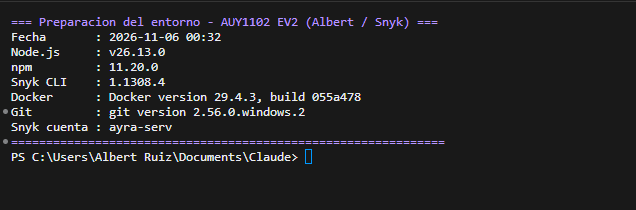
_Figura 1. Versiones instaladas y cuenta de Snyk autenticada (`ayra-serv`)._

## 4. Trabajo colaborativo: ramas, PR y reparto de hallazgos

Cada integrante trabajó en **su propia rama** y abrió un **Pull Request** que el otro revisó y aprobó.

| | Leonardo (SonarCloud) | Albert (Snyk) |
|---|---|---|
| Rama | `lortiz` | `fix/snyk-albert` |
| Pull Request | [#1 fix: remediate pug template injection](https://github.com/2026-2-AV-AUY1102-Grupo-7/AUY1102-EV2_LO_AR/pull/1) | [#2 fix: remediar vulnerabilidades Snyk…](https://github.com/2026-2-AV-AUY1102-Grupo-7/AUY1102-EV2_LO_AR/pull/2) |
| Aprobó y hizo merge | Albert | Leonardo |
| Hallazgos remediados | SSTI (`tssecurity:S5496`) y secreto en código (`yaml:S6418`) | node CVE-2025-55131, OpenSSL CVE-2023-2650 y CVE-2023-5678, chokidar (6 vulnerabilidades transitivas) |
| Archivos tocados | `src/quality/insecure-1-object.ts`, `credentials.yml`, `.gitignore` | `Dockerfile`, `package.json`, `package-lock.json`, `scripts/`, `.gitignore` |

**Integración:** el PR #1 entró primero a `master`. Antes de abrir el PR #2, se integró `master` en `fix/snyk-albert`. El único conflicto fue en `.gitignore`, porque ambos agregaron una línea al final, y se resolvió conservando las dos (`coverage` y `credentials.yml`).

## 5. Parte 1: Pruebas unitarias y cobertura

### 5.1 Script construido

Archivo: [`scripts/pruebas-unitarias.ps1`](scripts/pruebas-unitarias.ps1)

```powershell
powershell -ExecutionPolicy Bypass -File scripts\pruebas-unitarias.ps1
```

Qué hace:

1. Instala dependencias si falta `node_modules` (`npm ci`).
2. Ejecuta **todas las pruebas existentes** con Jest y cobertura (`jest --coverage --json`).
3. Muestra cada prueba como `[OK]` o `[FALLA]` y, en detalle, **las pruebas que fallan** con archivo y motivo.
4. Muestra la **cobertura global** (sentencias, ramas, funciones y líneas) y **por archivo**, con colores según umbral (verde ≥ 80 %, amarillo ≥ 50 %, rojo < 50 %).
5. Muestra el **código no cubierto**: rangos de líneas y el código de cada función sin probar.
6. Guarda la evidencia en `evidencias/pruebas/` (JSON, salida de Jest y resumen) y el reporte HTML/LCOV en `coverage/`.

### 5.2 Resultados

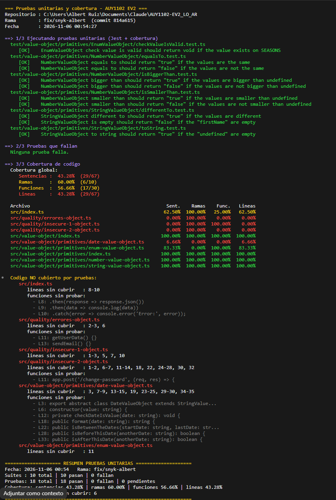
_Figura 2. 10 suites y 18 pruebas: todas pasan. Cobertura global y código no cubierto._

| Métrica | Resultado |
|---|---|
| Suites | 10 / 10 pasan |
| Pruebas | 18 / 18 pasan · 0 fallan |
| Sentencias | 43,28 % (29/67) |
| Ramas | 60,00 % (6/10) → **42,85 %** después del merge del PR #1 |
| Funciones | 56,66 % (17/30) |
| Líneas | 43,28 % (29/67) |

La cobertura de ramas bajó tras el PR #1 porque la corrección del SSTI agregó una rama nueva (`req.body.username ?? ''`) que ninguna prueba ejecuta.

### 5.3 Análisis de la cobertura

| Archivo | Líneas | Observación |
|---|---|---|
| `value-object/primitives/string-value-object.ts`, `number-value-object.ts`, `index.ts` | 100 % | Bien cubiertos por las pruebas existentes. |
| `value-object/primitives/enum-value-object.ts` | 83,33 % | Falta probar la rama de error (línea 11). |
| `value-object/primitives/date-value-object.ts` | 6,66 % | **Sin pruebas**: constructor, `format`, `isBetweenTheDates`, `isBeforeThisDate`, `isAfterThisDate`. |
| `src/index.ts` | 62,50 % | Las funciones de `fetch` (`then` / `catch`, líneas 8-10) no se ejecutan en las pruebas. |
| `src/quality/*.ts` | 0 % | Código de ejemplo intencionalmente inseguro, sin pruebas. |

**Recomendación:** priorizar pruebas para `DateValueObject`. Es lógica de dominio y es el archivo con menor cobertura.

## 6. Parte 2: Análisis de seguridad

### 6.1 SonarCloud (Leonardo)

**Configuración:** se conectó el repositorio de GitHub con SonarCloud y se agregó el proyecto `AUY1102-EV2_LO_AR` a la organización `2026-2-AV-AUY1102-Grupo-7`.

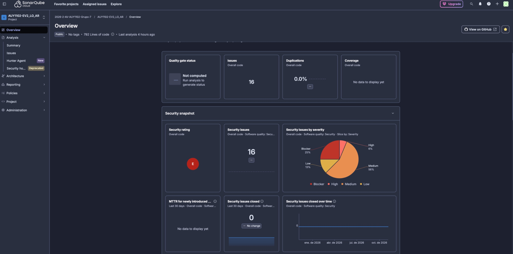
_Figura 3. SonarCloud antes de la remediación: 16 issues de seguridad, Security rating **E**, 792 líneas de código._

#### Hallazgo 1: Server-Side Template Injection (`tssecurity:S5496`)

En `src/quality/insecure-1-object.ts`, el valor `username` recibido en la petición HTTP se **interpolaba dentro del código fuente** de una plantilla Pug. Un atacante podía inyectar expresiones Pug o JavaScript que se ejecutaban en el servidor.

```js
// Antes (vulnerable)
const input = req.body.username;
const template = `... input(... value='${input}') ... p Hello ${input}`;
const fn = pug.compile(template);
const html = fn();
```

```js
// Después (remediado)
const username = req.body.username ?? '';
const template = pug.compile(`... input(... value=username) ... p Hello #{username}`);
const html = template({ username });
```

La plantilla queda estática y `username` se pasa como **dato** al renderizar, así que Pug lo escapa.

#### Hallazgo 2: Secreto en el código (`yaml:S6418`)

`credentials.yml` contenía un `token` en texto plano. Se eliminó del archivo versionado y `credentials.yml` se agregó a `.gitignore` (commit `46b0cb7`).

#### Pull Request

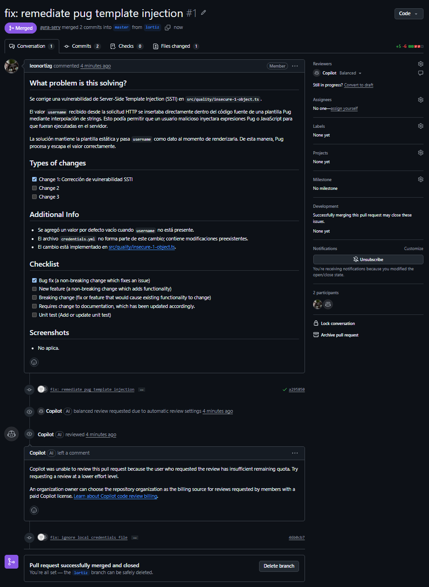
_Figura 4. PR #1 (`lortiz` → `master`) revisado y fusionado por Albert._

#### Resultado después de la remediación

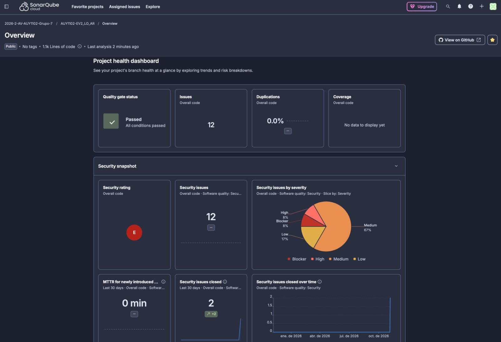
_Figura 4b. SonarCloud después de los merges: **Quality gate Passed**, issues de seguridad **16 → 12**, **2 issues de seguridad cerrados** (SSTI y secreto) y MTTR de 0 min._

| Métrica SonarCloud | Antes | Después |
|---|---|---|
| Quality gate | Not computed | **Passed** |
| Issues de seguridad | 16 | **12** |
| Issues de seguridad cerrados (30 días) | 0 | **2** |
| Security rating | E | E |
| Líneas de código | 792 | 1,1 k |

El _Security rating_ sigue en **E** porque quedan 12 issues de seguridad abiertos, incluidos algunos de severidad _Blocker_ y _High_ (8 % cada una), que no formaron parte de las remediaciones seleccionadas. El rating mejora recién cuando se cierran todos los issues de la severidad más alta.

### 6.2 Snyk (Albert)

#### 6.2.1 Conexión e importación

Se conectó Snyk con GitHub y se importó el repositorio. Snyk detectó dos proyectos: **`Dockerfile`** (Snyk Container) y **`package.json`** (Snyk Open Source).

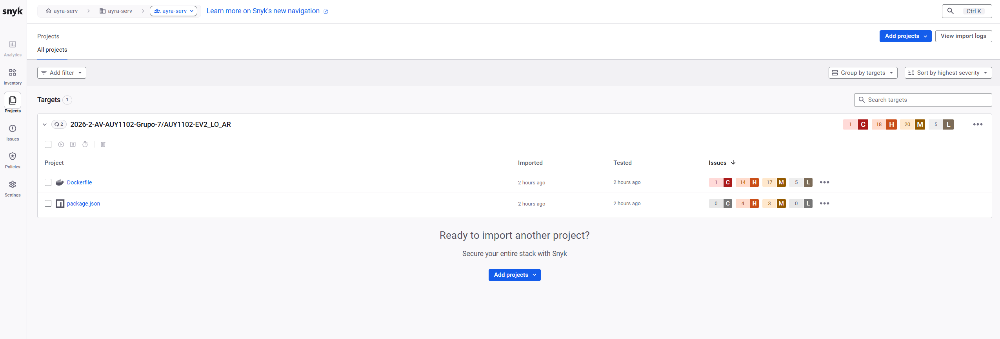
_Figura 5. Proyectos importados: Dockerfile (1C · 14H · 17M · 5L) y package.json (4H · 3M)._

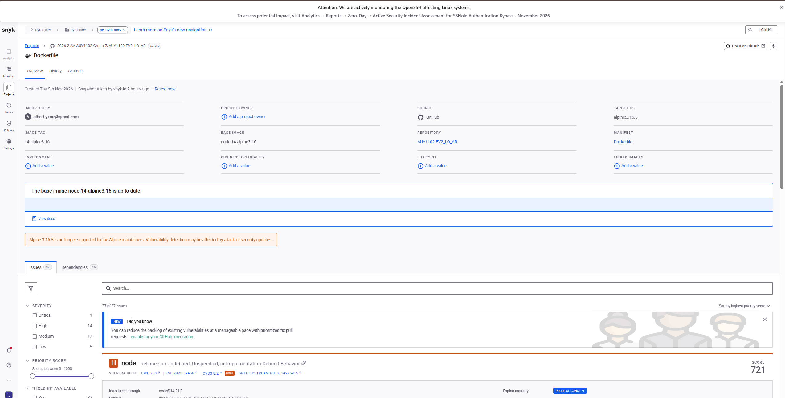
_Figura 6. Imagen base `node:14-alpine3.16`: 37 issues. Snyk advierte que Alpine 3.16.5 ya no tiene soporte._

#### 6.2.2 Hallazgos seleccionados

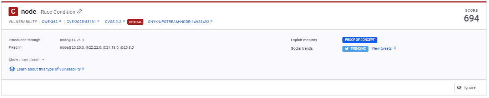
_Figura 7. `SNYK-UPSTREAM-NODE-14928492`: Race Condition en node 14.21.3, **Critical (CVSS 9.2)**, con exploit de prueba de concepto._

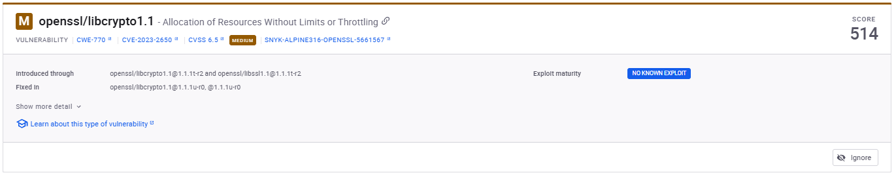
_Figura 8. `SNYK-ALPINE316-OPENSSL-5661567`: consumo de recursos sin límite en OpenSSL 1.1.1t, Medium (6.5)._

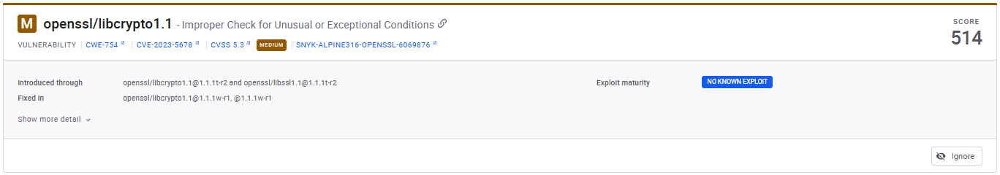
_Figura 9. `SNYK-ALPINE316-OPENSSL-6069876`: chequeo incorrecto de condiciones en OpenSSL 1.1.1t, Medium (5.3)._

Además, en `package.json`, la dependencia directa **`chokidar@2.0.3`** arrastraba 6 vulnerabilidades transitivas:

| Severidad | Vulnerabilidad | Paquete transitivo |
|---|---|---|
| High (8.2) | ReDoS | `decode-uri-component@0.2.2` |
| High (7.5) | Consumo excesivo de recursos en bucle | `braces@2.3.2` |
| High (8.7) | Recursión no controlada | `braces@2.3.2` |
| High (7.5) | Prototype Pollution | `unset-value@1.0.0` |
| Medium (5.3) | ReDoS | `glob-parent@3.1.0` |
| Medium (5.3) | Complejidad de regex ineficiente | `micromatch@3.1.10` |

#### 6.2.3 Script de escaneo (antes / después)

Archivo: [`scripts/escaneo-seguridad.ps1`](scripts/escaneo-seguridad.ps1). Escanea el **repositorio completo** y guarda los reportes en `evidencias/snyk/<etapa>/`.

```powershell
powershell -ExecutionPolicy Bypass -File scripts\escaneo-seguridad.ps1 -Etapa antes
powershell -ExecutionPolicy Bypass -File scripts\escaneo-seguridad.ps1 -Etapa despues
```

| Paso | Comando | Cobertura |
|---|---|---|
| 1 | `npm audit` | Todas las dependencias (incluye desarrollo) |
| 2 | `snyk test --all-projects` | Todos los manifiestos (Snyk Open Source) |
| 3 | `snyk code test` | Código fuente (Snyk Code / SAST) |
| 4 | `snyk iac test` | Archivos de infraestructura (Snyk IaC) |
| 5 | `snyk container test <FROM> --file=Dockerfile` | Imagen base del Dockerfile (Snyk Container) |

**Decisión técnica:** el primer intento construía la imagen con Docker Desktop, pero el motor de Docker no arrancó en el equipo (Figura 10). Se cambió a `snyk container test` sobre la imagen del `FROM`, que Snyk descarga directamente desde Docker Hub. Es el mismo análisis que hace el proyecto _Dockerfile_ del panel web y da los mismos 37 hallazgos.

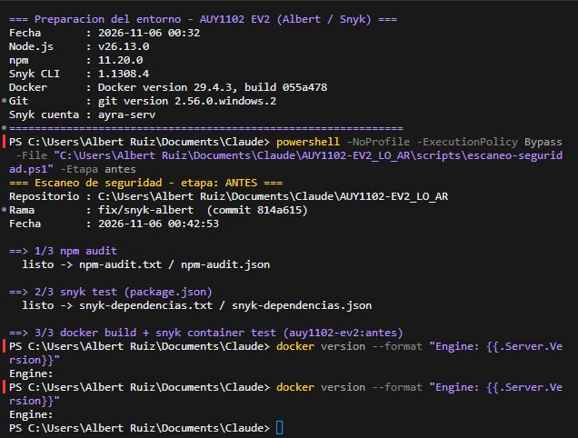
_Figura 10. Primer intento: el paso con `docker build` queda detenido porque el motor de Docker no responde._

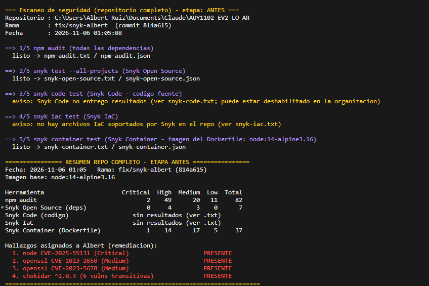
_Figura 11. **Antes** (commit `814a615`): npm audit 82 · Snyk Open Source 7 · Snyk Container 37. Los 4 hallazgos asignados aparecen como **PRESENTE**._

Snyk Code está deshabilitado en la organización de Snyk (`SNYK-CODE-0005`); el análisis SAST lo cubre SonarCloud. Snyk IaC no aplica, porque el repositorio no tiene archivos Terraform, Kubernetes ni CloudFormation.

#### 6.2.4 Remediación 1: imagen base del Dockerfile (Snyk Container)

```diff
- FROM node:14-alpine3.16
+ FROM node:24.22.2-alpine3.24
```

- Node 14 y Alpine 3.16 están **fuera de soporte (EOL)**.
- Se eligió **Node 24 LTS** con un **tag exacto** (≥ 24.13.0, versión de corrección indicada por Snyk), no `latest`, para tener builds reproducibles.
- Al pasar a Alpine 3.24 (OpenSSL 3), `libcrypto1.1` desaparece de la imagen, por lo que **un solo cambio cierra los 3 hallazgos**: node CVE-2025-55131 y OpenSSL CVE-2023-2650 / CVE-2023-5678.
- Se evaluó una alternativa intermedia (`node:14-alpine3.17`). Cerraba OpenSSL, pero **subía a 63 vulnerabilidades**, así que se descartó.
- Commit: `0c54718`.

#### 6.2.5 Remediación 2: dependencia chokidar (Snyk Open Source)

1. `chokidar ^2.0.3 → ^3.6.0` (commit `73dff5c`). El **re-escaneo** mostró 3 vulnerabilidades más recientes que seguían en el árbol de 3.6.0:
   - `SNYK-JS-BRACES-19963945` (High) vía `braces@3.0.3`
   - `SNYK-JS-PICOMATCH-15765511` (High) y `SNYK-JS-PICOMATCH-15765513` (Medium) vía `readdirp@3.6.0 > picomatch@2.3.1`
2. `chokidar ^3.6.0 → ^4.0.3` (commit `87fa553`). chokidar 4 elimina `braces` y `picomatch` de su árbol y es compatible con `engines: node >=14.16`. El código fuente no usa chokidar directamente, por lo que no hay impacto funcional.
3. **Prueba de regresión:** 18/18 pruebas pasan después de cada cambio.

Este ciclo de escanear, corregir y volver a escanear muestra por qué el análisis se debe repetir después de cada remediación.

#### 6.2.6 Resultado después de la remediación

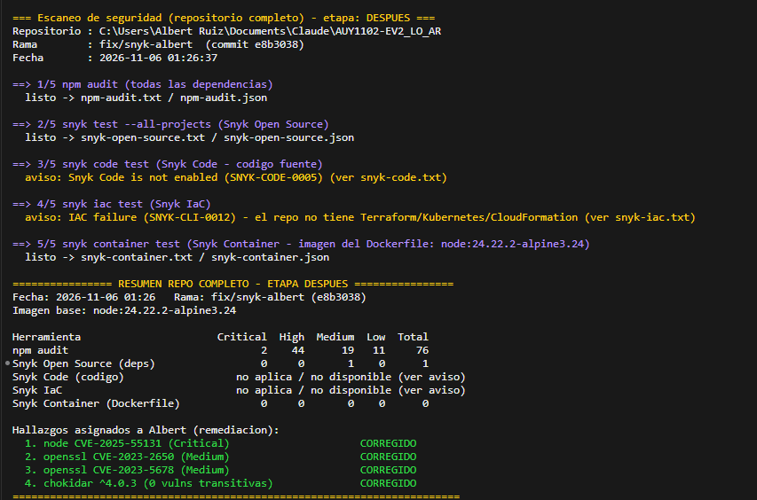
_Figura 12. **Después** (commit `e8b3038`): Snyk Container **0**, Snyk Open Source **1**, npm audit 76. Los 4 hallazgos aparecen como **CORREGIDO**._

| Escaneo | Antes | Después |
|---|---|---|
| Snyk Container | 37 (1C · 14H · 17M · 5L) | **0** |
| Snyk Open Source | 7 (4H · 3M) | **1** (M, `yaml` vía `cosmiconfig`, fuera de alcance) |
| npm audit | 82 (2C · 49H · 20M · 11L) | 76 (2C · 44H · 19M · 11L) |

#### 6.2.7 Pull Request

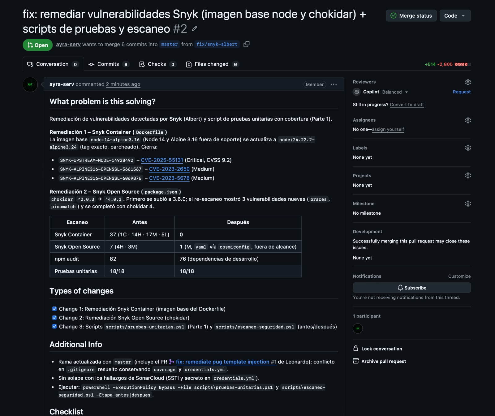
_Figura 13. PR #2 (`fix/snyk-albert` → `master`) con descripción de las remediaciones y tabla antes/después._

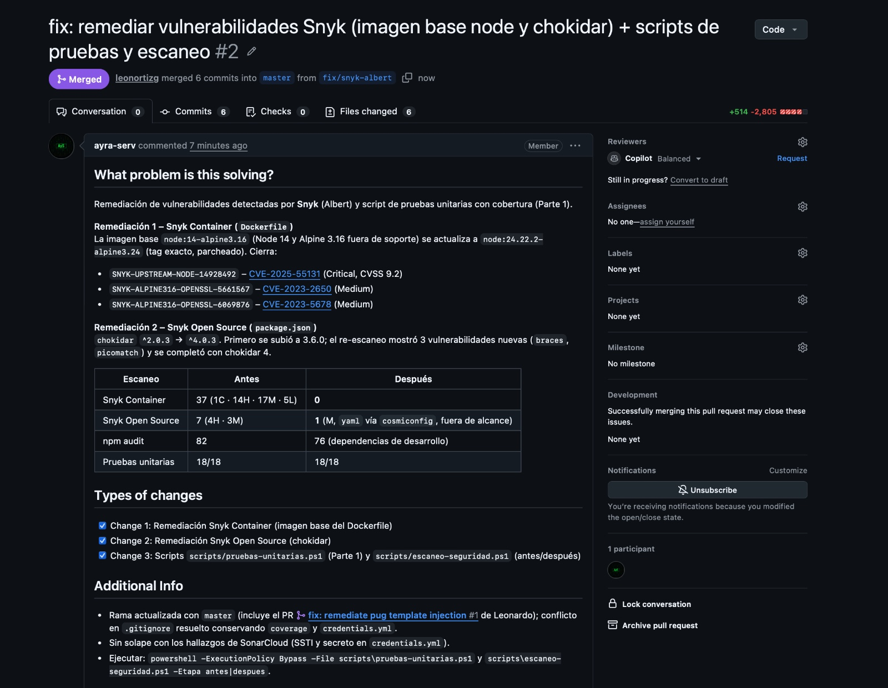
_Figura 14. PR #2 revisado y fusionado por Leonardo (6 commits)._

#### 6.2.8 Verificación en el panel de Snyk

Después del merge del PR #2 se ejecutó **Retest now** en ambos proyectos. El panel web confirma lo mismo que el escaneo por CLI:

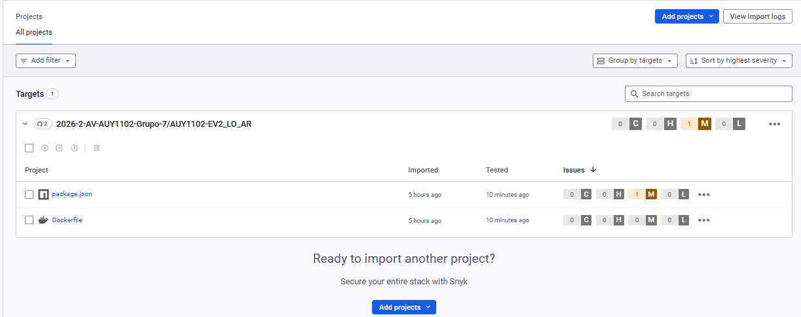
_Figura 15. Panel de Snyk después de la remediación: **Dockerfile 0 issues** (antes 1C · 14H · 17M · 5L) y **package.json 1 Medium** (antes 4H · 3M). El total del repositorio pasa de 1C · 18H · 20M · 5L a **0C · 0H · 1M · 0L**._

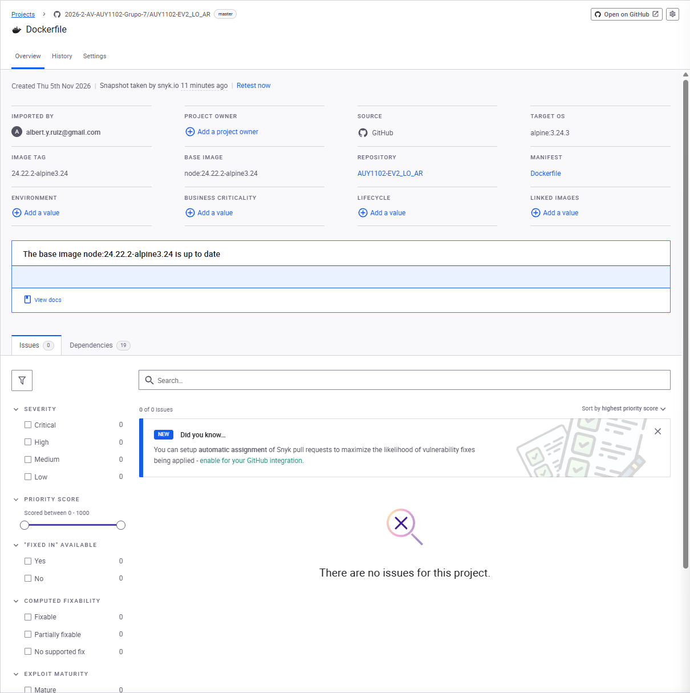
_Figura 16. Proyecto Dockerfile después: imagen base `node:24.22.2-alpine3.24` (Alpine 3.24.3), "The base image is up to date" y **0 issues** (comparar con la Figura 6: `node:14-alpine3.16` con 37 issues)._

### 6.3 npm audit

Se ejecuta como paso 1 del script de escaneo (`npm audit` y `npm audit --json`). Reportes en `evidencias/snyk/antes/npm-audit.txt` y `evidencias/snyk/despues/npm-audit.txt`.

- **Antes:** 82 paquetes vulnerables (2 Critical · 49 High · 20 Medium · 11 Low).
- **Después:** 76 (2 Critical · 44 High · 19 Medium · 11 Low).
- La diferencia con Snyk se debe a que **`npm audit` incluye las dependencias de desarrollo** (`@babel/*`, `semantic-release`, `eslint`, etc.), mientras que Snyk analiza por defecto solo las de producción. Los hallazgos restantes son herramientas de desarrollo que no se despliegan con la aplicación (ver sección 9).

### 6.4 GitHub Advanced Security

GitHub Advanced Security (GHAS) agrupa las herramientas de seguridad nativas de GitHub. En repositorios públicos es gratuito.

**Activación:** _Settings_ → _Security and quality_ → **Advanced Security**.

| Función | Estado | Para qué sirve |
|---|---|---|
| Dependency graph | **On** | Inventario de dependencias del `package-lock.json` |
| Dependabot alerts | **On** | **Análisis de dependencias**: alerta cuando una dependencia tiene un CVE conocido |
| Dependabot security updates | **On** | Abre PRs automáticos con la versión corregida |
| Secret Protection (secret scanning) | **On** | **Escaneo de secretos** en el código y en todo el historial de git |
| Push protection | **On** | Bloquea un `git push` que contenga un secreto soportado |

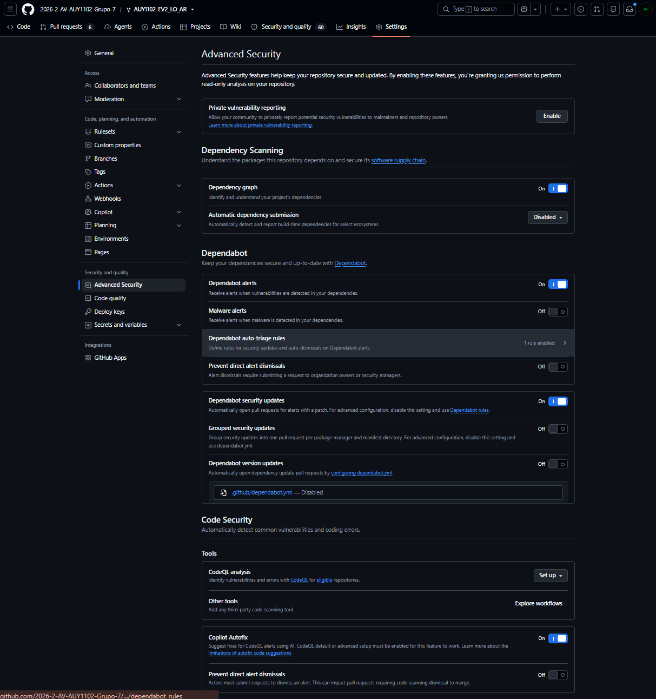
_Figura 17. Dependency graph, Dependabot alerts y Dependabot security updates activados._

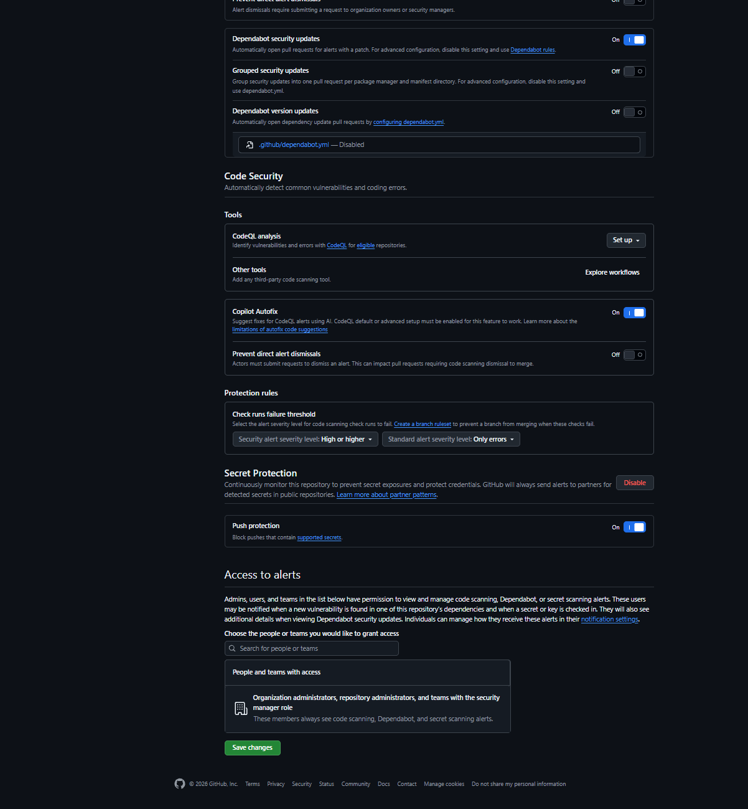
_Figura 18. Secret Protection activo (botón "Disable") y Push protection en **On**._

#### Resultado: análisis de dependencias (Dependabot)

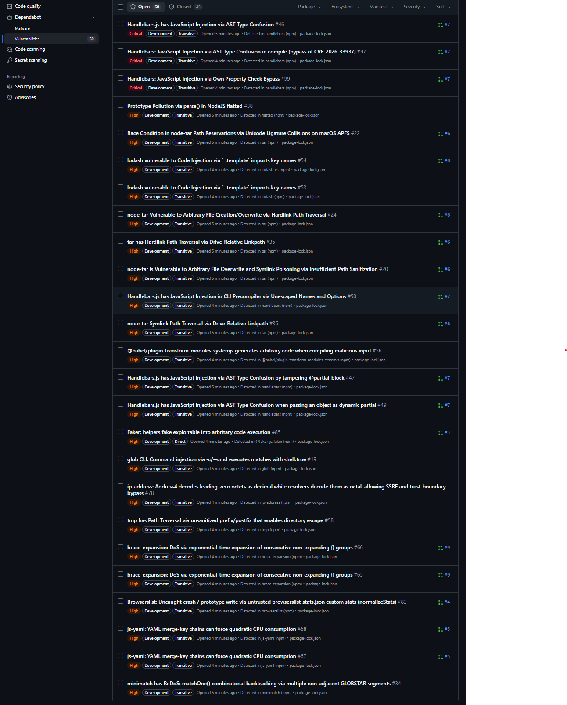
_Figura 19. Dependabot detectó **60 alertas abiertas** y **45 cerradas** minutos después de activarse. También abrió **6 PRs automáticos** de actualización._

- **Todas las alertas abiertas tienen la etiqueta `Development`** (por ejemplo `handlebars`, `tar`, `lodash`, `@babel/plugin-transform-modules-systemjs`, `brace-expansion`, `js-yaml`, `minimatch`, `@faker-js/faker`). Son herramientas de desarrollo, no dependencias que se despliegan con la aplicación.
- Esto confirma el hallazgo de `npm audit` (sección 6.3): las vulnerabilidades que quedan están en el _tooling_ de desarrollo. Snyk, que por defecto analiza solo producción, deja 1.
- Los PRs de Dependabot **no se aprobaron automáticamente**. Varios son saltos de versión mayor y deben pasar por las pruebas de regresión antes del merge.

#### Resultado: escaneo de secretos

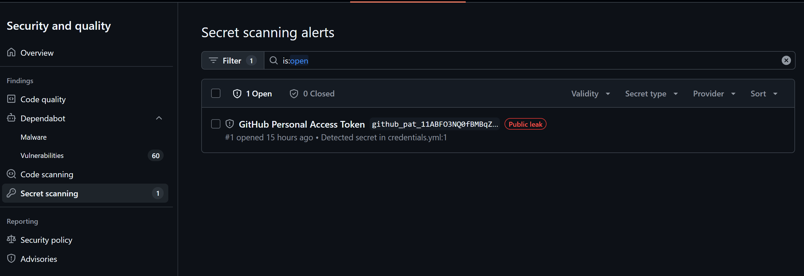
_Figura 20. Secret scanning: **0 secretos abiertos**. GitHub indica que está ejecutando un **escaneo completo del historial**._

- Al momento de la captura no hay secretos detectados. El escaneo del historial sigue en curso, y GitHub notifica por correo si encuentra alguno.
- El `.npmrc` contiene un token con formato de token personal de GitHub (`ghp_…`), un patrón que secret scanning reconoce. Si no aparece al terminar el escaneo, lo más probable es que GitHub ya lo haya revocado: en repositorios públicos, GitHub avisa automáticamente a los proveedores cuando detecta un secreto expuesto.
- El token genérico de `credentials.yml` (eliminado por Leonardo) **no corresponde a un proveedor conocido**, por lo que GHAS no lo reporta. En cambio, **SonarCloud sí lo detectó** (regla `yaml:S6418`): las herramientas son complementarias.
- Con **Push protection** activo, un nuevo `git push` con un secreto soportado queda bloqueado antes de llegar al repositorio (prevención y no solo detección).

El repositorio ya incluía `.github/dependabot.yml` (deshabilitado) y el workflow `.github/workflows/codeql.yml` para análisis de código con CodeQL.

## 7. Resultados consolidados

| Herramienta | Responsable | Hallazgos remediados | Antes | Después |
|---|---|---|---|---|
| SonarCloud | Leonardo | SSTI (`S5496`), secreto en código (`S6418`) | 16 issues de seguridad · rating E | **12** · Quality gate **Passed** |
| Snyk (panel web, total repo) | Albert | — | 1C · 18H · 20M · 5L (44) | **0C · 0H · 1M · 0L (1)** |
| Snyk Container | Albert | node CVE-2025-55131 (C), OpenSSL CVE-2023-2650 (M), CVE-2023-5678 (M) | 37 | **0** |
| Snyk Open Source | Albert | chokidar: 6 vulnerabilidades transitivas (4H · 2M) + 3 descubiertas en el re-escaneo | 7 | **1** |
| npm audit | Albert | (efecto de las remediaciones anteriores) | 82 | 76 |
| GHAS: Dependabot | Albert | Activado; 6 PRs automáticos propuestos | — | 60 abiertas (todas `Development`) · 45 cerradas |
| GHAS: Secret scanning | Albert | Activado con Push protection | — | 0 secretos abiertos (escaneo del historial en curso) |
| Pruebas unitarias | Albert | Script de ejecución y cobertura | 18/18 | 18/18 |

## 8. Evaluación de las herramientas en el ciclo de vida

| Herramienta | Qué detecta | Etapa del ciclo | Fortaleza | Limitación observada |
|---|---|---|---|---|
| **Jest + cobertura** | Errores de lógica; código sin probar | Desarrollo | Retroalimentación inmediata; base para regresión | La cobertura no mide la calidad de las aserciones |
| **SonarCloud** | Bugs, _code smells_, vulnerabilidades en código propio, secretos | Desarrollo / PR | Análisis del código propio (SAST) con contexto y guía de corrección | No analiza versiones de dependencias ni de la imagen base |
| **Snyk Open Source / Container** | CVE en dependencias e imágenes base | Desarrollo / PR / build | Indica la versión exacta de corrección y la ruta de dependencia | El proyecto web solo sigue `master`; Snyk Code requiere habilitarse |
| **npm audit** | CVE en todo el árbol npm | Desarrollo / CI | Nativo, sin configuración | No distingue producción de desarrollo en el conteo; mucho ruido |
| **GHAS** | Dependencias vulnerables (Dependabot), secretos, CodeQL | Repositorio / PR | Integrado en GitHub; _push protection_ evita subir secretos | Requiere activación por repositorio |

**Detección temprana (_shift-left_):** las herramientas son complementarias. SonarCloud cubre el código propio y Snyk/npm audit/Dependabot cubren el código de terceros. Ejecutarlas en cada PR, antes del merge, evita que lleguen a `master` cambios con vulnerabilidades conocidas y reduce el costo de corrección.

## 9. Riesgos residuales y recomendaciones

| Riesgo | Recomendación |
|---|---|
| `yaml@1.10.2` vía `cosmiconfig@6.0.0` (Medium) | Actualizar `cosmiconfig` a una versión que use `yaml ≥ 1.10.3`. |
| 76 hallazgos de `npm audit` en dependencias de desarrollo | Actualizar el tooling (`@babel/*`, `semantic-release`, `eslint`) en un ciclo aparte, con pruebas de regresión. |
| El token de `credentials.yml` sigue en el **historial de git** | **Revocar o rotar** el token y moverlo a GitHub Secrets (`${{ secrets.NOMBRE }}`). |
| `.npmrc` contiene un token de GitHub Packages en texto plano | Revocarlo y usar una variable de entorno (`//npm.pkg.github.com/:_authToken=${NPM_TOKEN}`). |
| Dockerfile: `COPY . .` antes de `WORKDIR` y ejecución como `root` | Definir `WORKDIR` primero, agregar `.dockerignore` y `USER node`. |
| Cobertura de líneas 43 % | Agregar pruebas para `DateValueObject` y para la nueva rama de `insecure-1-object.ts`. |
| Análisis solo manual | Integrar `scripts/pruebas-unitarias.ps1`, `snyk test` y SonarCloud en GitHub Actions sobre cada PR. |

## 10. Conclusiones

- Se construyó un **script de pruebas unitarias** que muestra resultados, pruebas fallidas, cobertura y código no cubierto. Todas las pruebas existentes pasan (18/18) y la cobertura de líneas es de 43 %.
- **SonarCloud** permitió corregir una inyección de plantillas (SSTI) y retirar un secreto del código: los issues de seguridad bajaron de 16 a 12 y el _Quality gate_ quedó en **Passed**.
- **Snyk** permitió eliminar **todas las vulnerabilidades de la imagen** (37 → 0), incluida una **crítica**, y reducir las de dependencias de producción de 7 a 1. En el panel web, el repositorio pasó de **44 a 1** vulnerabilidad, sin críticas ni altas.
- **GitHub Advanced Security** quedó activado (Dependabot y Secret scanning con Push protection). Dependabot confirmó que las vulnerabilidades restantes están en dependencias de desarrollo y propuso sus actualizaciones mediante PRs.
- El **re-escaneo** fue clave: la primera actualización de chokidar no bastó y el ciclo de escanear y corregir permitió completar la remediación.
- El flujo con **ramas por integrante, Pull Requests y revisión cruzada** simula un entorno profesional y deja trazabilidad de cada cambio.

## 11. Anexos

### 11.1 Commits

| Commit | Autor | Descripción |
|---|---|---|
| `a295850` | Leonardo | fix: remediate pug template injection |
| `46b0cb7` | Leonardo | fix: ignore local credentials file |
| `13be573` | — | Merge PR #1 (`lortiz`) |
| `88756e0` | Albert | feat(scripts): script de pruebas unitarias y script de escaneo de seguridad |
| `0c54718` | Albert | fix(docker): imagen base `node:14-alpine3.16` → `node:24.22.2-alpine3.24` |
| `73dff5c` | Albert | fix(deps): chokidar `^2.0.3` → `^3.6.0` |
| `87fa553` | Albert | fix(deps): chokidar `^3.6.0` → `^4.0.3` |
| `e8b3038` | Albert | fix(scripts): conteo de listas vacías en el resumen |
| `b0b8f21` | Albert | Merge `master` en `fix/snyk-albert` (conflicto `.gitignore` resuelto) |
| `cc55b31` | — | Merge PR #2 (`fix/snyk-albert`) |

### 11.2 Evidencias en el repositorio

```
docs/evidencias/albert/     capturas de Albert (entorno, pruebas, Snyk, PR #2)
docs/evidencias/leonardo/   capturas de Leonardo (SonarCloud, PR #1)
evidencias/pruebas/         salida de Jest, resultados JSON, código no cubierto
evidencias/snyk/antes/      npm audit + Snyk (txt/json) antes de remediar
evidencias/snyk/despues/    npm audit + Snyk (txt/json) después de remediar
```

### 11.3 Cómo reproducir

```powershell
git clone https://github.com/2026-2-AV-AUY1102-Grupo-7/AUY1102-EV2_LO_AR.git
cd AUY1102-EV2_LO_AR
npm ci --ignore-scripts
snyk auth
powershell -ExecutionPolicy Bypass -File scripts\pruebas-unitarias.ps1
powershell -ExecutionPolicy Bypass -File scripts\escaneo-seguridad.ps1 -Etapa despues
```
